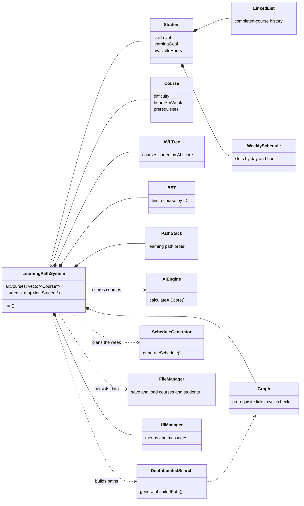
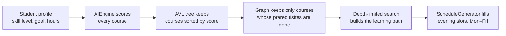

# EDUFLOW

**Personalized AI Learning Path Generator**

A comprehensive C++ application for managing personalized learning paths with AI-powered course recommendations, smart scheduling, and multi-role interfaces for students, administrators, and counselors.

<p align="center">
  
</p>

<p align="center"><sub>Real output from the program: create a profile, complete a course, get recommendations, generate a learning path and a weekly schedule.</sub></p>

## Project Structure

```
EDUFLOW/
├── include/               # Header files (.h)
│   ├── Enumerations.h
│   ├── UtilityFunctions.h
│   ├── Course.h
│   ├── ScheduleSlot.h
│   ├── WeeklySchedule.h
│   ├── ProgressReport.h
│   ├── AVLTree.h
│   ├── BST.h
│   ├── Graph.h
│   ├── LinkedList.h
│   ├── PathStack.h
│   ├── DepthLimitedSearch.h
│   ├── AIEngine.h
│   ├── Student.h
│   ├── ScheduleGenerator.h
│   ├── FileManager.h
│   ├── UIManager.h
│   └── LearningPathSystem.h
├── src/                   # Implementation files (.cpp)
│   ├── UtilityFunctions.cpp
│   ├── Course.cpp
│   ├── ScheduleSlot.cpp
│   ├── WeeklySchedule.cpp
│   ├── ProgressReport.cpp
│   ├── AVLTree.cpp
│   ├── BST.cpp
│   ├── Graph.cpp
│   ├── LinkedList.cpp
│   ├── PathStack.cpp
│   ├── DepthLimitedSearch.cpp
│   ├── AIEngine.cpp
│   ├── Student.cpp
│   ├── ScheduleGenerator.cpp
│   ├── FileManager.cpp
│   ├── UIManager.cpp
│   ├── LearningPathSystem.cpp
│   └── main.cpp
├── Makefile               # Build configuration
├── .gitignore            # Git ignore rules
└── README.md             # This file
```

## Features

- **AI-Powered Recommendations**: Intelligent course recommendations based on student skills, goals, and available time
- **Smart Scheduling**: Automated weekly schedule generation
- **Progress Tracking**: Comprehensive progress reports with skill tracking
- **Multi-Role Interface**: Separate interfaces for students, administrators, and counselors
- **Data Persistence**: File-based storage for courses and student data
- **Advanced Data Structures**: 
  - AVL Tree for optimized course sorting
  - BST for fast course lookup
  - Graph for prerequisite management
  - Linked List for course history

## Building the Project

### Prerequisites

- C++ compiler with C++11 support (g++, clang++)
- Make (optional, for using Makefile)

### Using Makefile

```bash
# Build the project
make

# Clean build artifacts
make clean

# Rebuild from scratch
make rebuild
```

### Using CMake

```bash
# Create build directory
mkdir build && cd build

# Generate build files
cmake ..

# Build the project
make

# Run the application
./eduflow
```

### Manual Compilation

```bash
# Compile all source files
g++ -std=c++11 -Wall -Iinclude src/*.cpp -o eduflow

# Or compile individually
g++ -std=c++11 -Wall -Iinclude -c src/*.cpp
g++ -std=c++11 -Wall *.o -o eduflow
```

## Running the Application

```bash
./eduflow
```

## Usage

The application provides three main interfaces:

1. **Student Portal**: View profile, get AI recommendations, generate learning paths, complete courses
2. **Admin Dashboard**: Manage courses, view statistics, backup data
3. **Doctor/Counselor Interface**: Monitor student mental health, view progress reports, add medical notes

## Architecture

`LearningPathSystem` owns the data and the data structures; each one has a single job.



### How a learning plan is made



The score adds up four parts: goal match (35), difficulty match for the student's level (30), whether the weekly hours fit (20) and whether the prerequisites are complete (15).

### Core Components

- **Enumerations**: Defines difficulty levels, skill levels, user roles, and schedule days
- **Course**: Manages course information, prerequisites, and serialization
- **Student**: Handles student profiles, progress, and skill tracking
- **AIEngine**: Calculates personalized course recommendations
- **Graph**: Manages course prerequisites and dependencies
- **ScheduleGenerator**: Creates optimized weekly schedules
- **FileManager**: Handles data persistence
- **UIManager**: Manages console-based user interface
- **LearningPathSystem**: Main system orchestrator

### Data Structures Used

- **AVL Tree**: Self-balancing BST for sorted course recommendations
- **Binary Search Tree**: Fast course lookup by ID
- **Graph**: Prerequisite dependency management
- **Linked List**: Course completion history
- **Stack**: Learning path generation

## License

This project is part of an educational system.